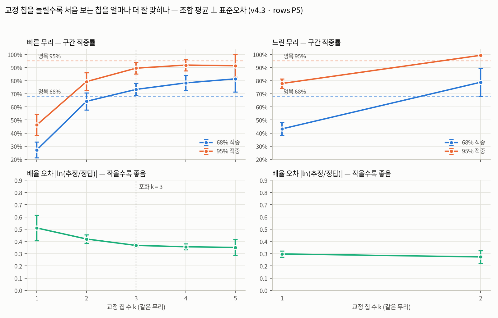

# inverse_learning_curve_2026-10 — 교정 칩 수에 따른 역산 성능 (학습 곡선, v4.3)

> 수치와 표만 둔다. 판단은 로그 52 §16. **브랜치 `inverse-v4.3-ceiling` 의 결과 — main 머지 전.**

- **무엇**: 같은 무리에서 교정 칩 k 개만 골라 교정하고, 나머지 칩을 처음 보는 칩으로 맞혔을 때의 성능. k 를 늘려도 좋아지지 않으면(포화) 교정 칩 9개가
  이 측정으로 낼 수 있는 성능에 이미 닿았다는 근거가 된다
- **방법** (`host/analysis/inverse_learning_curve.py` 머리): k 칩을 고르는 **모든 조합**(빠른 6칩 → k 1-5 의 6 · 15 · 20 · 15 · 6가지, 느린 3칩 → k 1-2 의 3 · 3가지)마다
  고른 칩으로만 교정 → 같은 무리 나머지 칩 전부를 12개 정답 지점(1k · 3k · 10k-100k)에서 맞힘. 관측은 등록 LOCO 와 같은 rows P5(실제 A 행 사이클 5개) × 5회.
  모델은 확정 v4.3(사후 평균 · ρ 0.00 · 0.78 · 0.21). R 은 고른 칩들의 속도 흩어짐에서 유도되어 k = 1 이면 1(칩 간 차이를 모름)
- **값**: 조합 평균 ± 조합 간 표준오차. 조합 하나 = 나머지 칩 × 12점 × 5회의 평균
- **포화 판정 (측정 전 고정)**: 그 뒤의 모든 k → k+1 에서 배율 오차 · 68% · 95% 적중의 변화가 전부 두 k 의 표준오차 합 안에 드는 가장 작은 k.
  처음엔 배율 오차 하나로 정했으나 반복 1회 시험에서 95% 적중이 46 → 79% 로 뛰는데도 「k=1 포화」 로 나와 셋 다 보도록 고쳤다(본 측정 전, 경위는 스크립트 머리)
- **한계**: ρ 는 9칩 전체로 잰 등록값을 고정해 썼다(약한 정보 누설 — k 가 작을 때 성능을 조금 좋게 본다). 느린 무리는 3칩이라 k = 2 까지뿐

## 결과

| 무리 | 교정 칩 k | 조합 | 68% 적중 | 95% 적중 | 배율 오차 \|ln\| | 68% 폭 (사이클) |
|---|---|---|---|---|---|---|
| 빠른 | 1 | 6 | 27.2% ± 6.0% | 46.3% ± 8.1% | 0.510 ± 0.103 | 6,667 |
| 빠른 | 2 | 15 | 64.2% ± 6.5% | 79.3% ± 6.8% | 0.420 ± 0.034 | 36,600 |
| 빠른 | 3 | 20 | 73.3% ± 4.6% | 89.5% ± 4.3% | 0.367 ± 0.012 | 41,775 |
| 빠른 | 4 | 15 | 78.3% ± 5.6% | 91.9% ± 4.3% | 0.356 ± 0.024 | 44,067 |
| 빠른 | 5 | 6 | 81.4% ± 10.1% | 91.4% ± 8.6% | 0.351 ± 0.065 | 44,583 |
| 느린 | 1 | 3 | 43.2% ± 5.1% | 77.9% ± 3.5% | 0.298 ± 0.025 | 8,333 |
| 느린 | 2 | 3 | 78.8% ± 10.7% | 99.3% ± 0.7% | 0.274 ± 0.053 | 23,500 |

포화 지점(빠른): k = 3 (그 뒤 k → k+1 에서 배율 오차 · 68% · 95% 적중 변화가 모두 조합 간 표준오차 합 안)

포화 지점(느린): 판정 안 됨 (마지막 k 까지 변화가 표준오차를 넘거나 점이 부족)



- **빠른 무리는 k = 3 에서 포화.** 1 → 3칩에서 68% 적중 27 → 73% · 95% 46 → 90% · 배율 오차 0.51 → 0.37 로 크게 좋아지고, 3 → 5칩은 73 → 81% · 90 → 91% · 0.37 → 0.35 로
  표준오차 안에서만 움직인다
- **k = 1 은 과신이다.** 68% 폭이 6,700 사이클로 좁은데 적중은 27% — 칩 간 속도 차이(R)를 잴 칩이 없어 모델이 「교정 칩과 똑같이 늙는다」 고 가정하기 때문.
  칩 간 흩어짐을 재려면 최소 2-3칩이 필요하다는 것이 곡선의 앞부분이다
- **느린 무리는 판정 불가.** 1 → 2칩에서 68% 43 → 79% · 95% 78 → 99% 로 아직 오르는 중이다. 상온 느린 칩을 하나 더(4칩) 돌리면 k = 3 점이 생긴다
- 포화 뒤 남는 오차(배율 오차 약 0.35 = 약 1.4배)는 교정 칩 수가 아니라 **칩마다 늙는 속도가 다른 몫**(R · ρ_chip)이다 — 칩을 더 사도 안 줄어드는 성분

## 재현

```bash
uv run python host/analysis/inverse_learning_curve.py --reps 5 --out build/inverse/lc --plot docs/results/plots/inverse_learning_curve_2026-10.png
```
